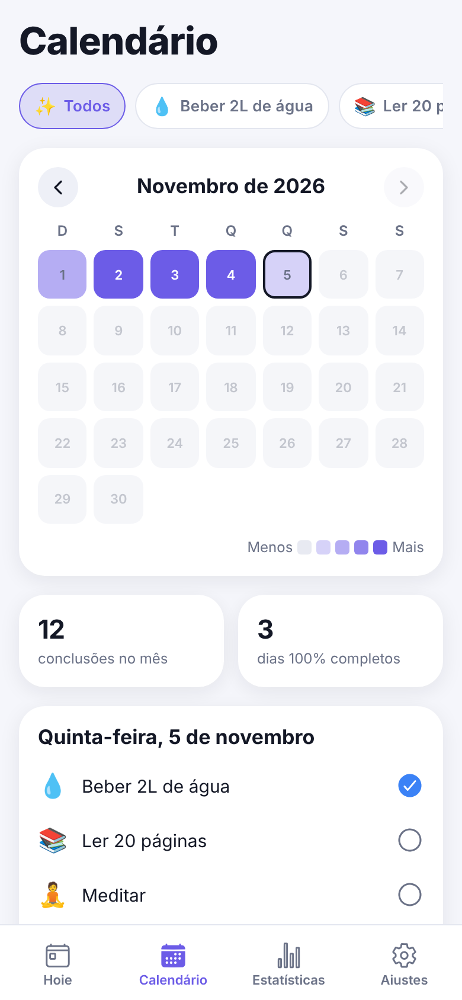
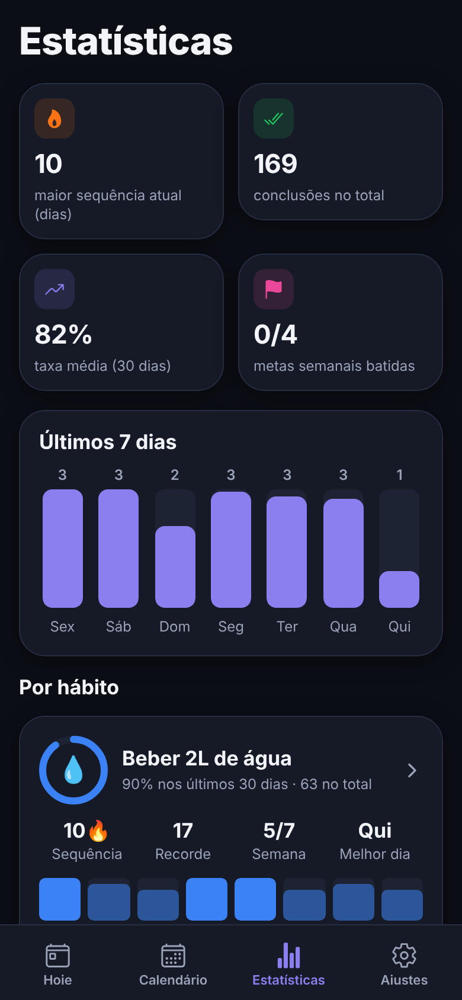
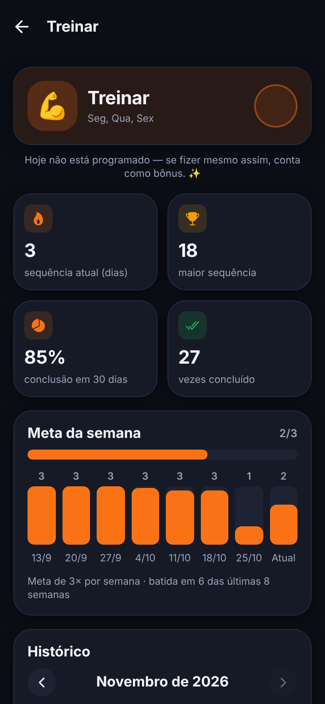

# Habit Track ✅

App de **hábitos e metas** feito com React Native + Expo. Crie hábitos diários ou para dias específicos da semana, marque o que já fez, acompanhe sua sequência de dias, veja o calendário em formato *heatmap*, confira estatísticas e receba lembretes no celular.

🌐 **Versão web:** https://arthursouzas.github.io/habit-track

<p align="center">
  
  
  
  
</p>

## ✨ Funcionalidades

- **Hábitos diários ou semanais**: escolha "todos os dias" ou os dias da semana em que o hábito vale.
- **Marcar como feito**: botão com animação e vibração (no celular). Dá para marcar dias anteriores pela semana ou pelo calendário.
- **Sequência de dias** 🔥: conta os dias programados seguidos. Dias fora da programação não quebram a sequência, e o dia de hoje só conta como falha depois que acaba.
- **Calendário heatmap**: mapa de calor mensal com todos os hábitos juntos ou um de cada vez.
- **Estatísticas por hábito**: sequência atual e recorde, taxa de conclusão em 30 dias, total de conclusões, melhor dia da semana e histórico das metas semanais.
- **Metas semanais**: defina quantas vezes por semana quer cumprir cada hábito e acompanhe o progresso.
- **Lembretes**: notificações locais diárias ou nos dias escolhidos (iOS e Android).
- **Modo escuro e claro**: segue o sistema ou é escolhido manualmente.
- **Dados locais**: tudo fica salvo no aparelho com AsyncStorage, sem login nem servidor.
- **Hábitos de exemplo**: um toque cria hábitos com 10 semanas de histórico para explorar o app.

## 🧱 Tecnologias

| Área | Ferramenta |
| --- | --- |
| App | [Expo SDK 58](https://expo.dev), React Native 0.88, React 19, TypeScript |
| Navegação | Expo Router (abas + pilha, rotas baseadas em arquivos) |
| Animações | React Native Reanimated 4 |
| Gráficos | react-native-svg (anéis de progresso) e componentes próprios |
| Dados | `@react-native-async-storage/async-storage` |
| Lembretes | `expo-notifications` (notificações locais) |
| Testes | Jest (`jest-expo`) + React Native Testing Library |
| Deploy | `expo export` para web + GitHub Actions + GitHub Pages |

## 📱 Como abrir no Expo Go

1. Instale o **Expo Go** no celular ([Android](https://play.google.com/store/apps/details?id=host.exp.exponent) / [iOS](https://apps.apple.com/app/expo-go/id982107779)). Use uma versão compatível com o **SDK 58**.
2. Clone o projeto e instale as dependências (Node.js 20 ou mais recente):

   ```bash
   git clone https://github.com/arthursouzas/habit-track.git
   cd habit-track
   npm install
   ```

3. Inicie o servidor de desenvolvimento:

   ```bash
   npx expo start
   ```

4. Escaneie o QR code que aparece no terminal:
   - **Android**: pelo próprio app Expo Go ("Scan QR code").
   - **iOS**: pela câmera do iPhone, que abre o Expo Go.

   Celular e computador precisam estar na mesma rede Wi-Fi. Se a rede bloquear a conexão, use `npx expo start --tunnel`.

> 💡 Os lembretes usam notificações **locais**, que funcionam no Expo Go. Na primeira vez que você ativar um lembrete, o app pede permissão para enviar notificações. Na versão web os lembretes ficam desativados.

## 💻 Rodar na web

```bash
npm run web
```

Para gerar a mesma versão publicada no GitHub Pages:

```bash
npm run build:web
```

Os arquivos estáticos ficam em `dist/`, usando a base `/habit-track/` (definida em `experiments.baseUrl` no `app.json`).

## 🧪 Testes e qualidade

```bash
npm test           # Jest + Testing Library
npm run typecheck  # TypeScript
npm run lint       # ESLint (eslint-config-expo)
```

Os testes cobrem:

- `src/lib/__tests__/streak.test.ts`: regras de sequência (dias programados, bônus, dia de hoje em aberto, recorde).
- `src/lib/__tests__/stats.test.ts`: taxa de conclusão, metas semanais, distribuição por dia da semana, heatmap e visão geral.
- `src/lib/__tests__/dates.test.ts`: utilitários de datas locais e formatação em português.
- `src/context/__tests__/habits-context.test.tsx`: criação de hábitos e marcação de dias via `renderHook`.
- `src/components/__tests__/weekday-picker.test.tsx`: interação com o seletor de dias da semana.

## 🚀 Deploy no GitHub Pages

O workflow [`.github/workflows/deploy.yml`](.github/workflows/deploy.yml) roda a cada push na `main`:

1. Instala as dependências e roda tipagem, lint e testes.
2. Executa `npx expo export --platform web`.
3. Copia `index.html` para `404.html`, para que links diretos funcionem (SPA), e publica `dist/` no GitHub Pages.

> No primeiro deploy, vá em **Settings → Pages** no repositório e escolha **GitHub Actions** em *Source*.

## 🗂️ Estrutura

```
src/
├── app/                    # Rotas (Expo Router)
│   ├── (tabs)/             # Hoje, Calendário, Estatísticas, Ajustes
│   └── habit/              # Novo hábito, detalhes e edição
├── components/             # Cards, heatmap, anel de progresso, formulário…
├── context/                # Estado dos hábitos e tema (claro/escuro)
├── hooks/                  # useToday (vira o dia automaticamente)
├── lib/                    # Regras de negócio: datas, sequência, estatísticas, notificações
├── storage/                # Persistência com AsyncStorage
└── types/                  # Tipos do domínio
```

## 👤 Autor

Feito por **Arthur Souza Soares** para o portfólio.

- GitHub: [@arthursouzas](https://github.com/arthursouzas)

## 📄 Licença

[MIT](LICENSE)
